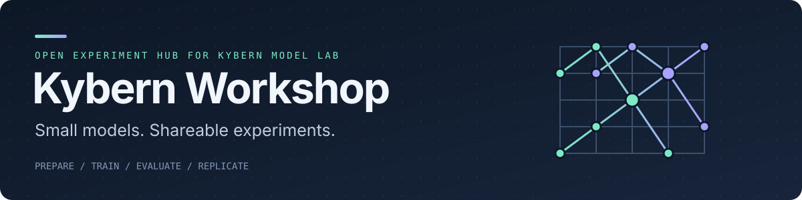

<p align="center">
  
</p>

<p align="center">
  <a href="https://github.com/supernovae/kybern-workshop/actions/workflows/tinystories-rocm.yml"></a>
  <a href="https://github.com/supernovae/model-lab"></a>
  <a href="https://github.com/supernovae/model-lab"></a>
  <a href="docs/native-workflow.md"></a>
  <a href="https://kybern.dev"></a>
</p>

<p align="center">
  <a href="https://kybern.dev/models/tinystories-training/">TinyStories Guide</a> ·
  <a href="examples/synthetic-cpu/README.md">Basic CPU Smoke</a> ·
  <a href="components/README.md">Custom Components</a> ·
  <a href="experiments/devmind/README.md">Devmind</a> ·
  <a href="#community-experiments--forks">Community Experiments</a> ·
  <a href="https://kybern.dev/experiments/">Kybern Research</a>
</p>

**Kybern Workshop** holds the experiment recipes we run with **[Kybern Model Lab](https://github.com/supernovae/model-lab)**: dataset locks, tokenizer configs, model `RunConfig` files, `try` changes, and the recorded outputs of each run. Use them to see exactly what we ran, repeat a run on your own hardware, or copy a recipe and test your own idea.

We publish everything we record, including negative results and models whose validation loss improved while their stories still failed our rubric. Small models are easier to understand when you can see where they go wrong.

A few things to know before you start:

- You only need this repository and Lab to run the recipes.
- The TinyStories quality scores come from an AI assistant applying a written rubric. No human panel reviewed them yet, so treat them as provisional.
- We don't publish model weights. A reproduction trains its own model and gets its own run IDs.

---

## Active Experiments & Recipes

| Experiment | What it tests | Status & Evidence | Links |
| --- | --- | --- | --- |
| **TinyStories Baseline (4.46M)** | An 8,192-update (33.5M-token) training run on CPU of a 4-layer dense transformer, with a 12-prompt story continuation panel. | **Completed.** Validation loss reached `1.7043` (perplexity `5.4976`), but 22 of 24 scored continuations failed the quality rubric. A good baseline to try to beat. | [Walkthrough](examples/tinystories-useful/README.md) · [27 Recorded Outputs](results/2026-10-19-tinystories-cpu/README.md) · [Interactive Guide](https://kybern.dev/models/tinystories-training/) |
| **TinyStories Microlab** | A starter comparison of FFN width 256 and 384 on 2,000 stories, using `klab try`. | **Ready to run.** A 40-update (10,240-target) exercise for learning the `klab` workflow. | [Microlab Guide](examples/tinystories-microlab/README.md) |
| **Basic Synthetic CPU** | An offline end-to-end check: generate synthetic text, fit a BPE tokenizer, train one step, evaluate, and write a report. | **Recorded.** Runs offline on CPU and downloads nothing. | [Recipe Guide](examples/synthetic-cpu/README.md) · [Recorded Result](results/2026-10-14-synthetic-cpu/README.md) · [Offline Check (kybern.dev)](https://kybern.dev/models/cpu-smoke/) |
| **Devmind (730M)** | A from-scratch, development-leaning decoder with a 32,768-token context, sparse latent attention and n-gram memory from the first update: pinned sources, a 12B-token mixture, pretraining, long-context, chat and preference stages. | **Defined, not trained.** Declarations load with Lab; the model shape was measured for a few updates on one Arc Pro B70. The README lists the measured numbers and the open Lab gaps. | [Recipe](experiments/devmind/README.md) · [Corpus](experiments/devmind/corpus/README.md) · [Post-training](experiments/devmind/post-training/README.md) |

---

## Running Workshop Experiments with Kybern Model Lab

Every recipe here runs with **[Kybern Model Lab](https://github.com/supernovae/model-lab)**.
Install **Python 3.14** and [uv](https://docs.astral.sh/uv/), then clone both repositories side by side:

```sh
git clone https://github.com/supernovae/model-lab.git
git clone https://github.com/supernovae/kybern-workshop.git

cd model-lab
uv sync --locked --extra cpu --dev
export KLAB_WORK_DIR="$HOME/.local/share/klab"
```

### 1. Run a Quick Offline CPU Smoke Test

Check that your install works end to end. This downloads nothing (more in the [offline installation check on kybern.dev](https://kybern.dev/models/cpu-smoke/)):

```sh
uv run --locked --extra cpu klab readiness smoke --family dense \
  --output "$KLAB_WORK_DIR/first-run"
uv run --locked --extra cpu klab dashboard --runs-dir "$KLAB_WORK_DIR/first-run/runs"
```

To see or repeat the full multi-stage synthetic recipe, follow [`examples/synthetic-cpu/README.md`](examples/synthetic-cpu/README.md).

### 2. Run Your First Controlled Comparison (`TinyStories Microlab`)

Copy the [TinyStories microlab](examples/tinystories-microlab/README.md) config files into a fresh workspace, prepare the dataset and a 2,048-token BPE tokenizer once, then test whether a wider feed-forward layer (`ffn_dim: 384` instead of `256`) lowers held-out loss at the same token budget:

```sh
EXPERIMENT="$KLAB_WORK_DIR/experiments/tinystories-microlab-001"
SAMPLE="../kybern-workshop/examples/tinystories-microlab/declarations"
mkdir -p "$EXPERIMENT/inputs"
cp "$SAMPLE/source.yaml" "$SAMPLE/tokenizer.yaml" "$SAMPLE/run.yaml" "$EXPERIMENT/inputs/"

# 1. Lock and snapshot the TinyStories subset, then fit the tokenizer
uv run --locked --extra cpu klab data lock "$EXPERIMENT/inputs/source.yaml" \
  --output "$EXPERIMENT/inputs/source.lock.json"
uv run --locked --extra cpu klab data snapshot "$EXPERIMENT/inputs/source.lock.json" \
  --output "$EXPERIMENT/snapshot"
uv run --locked --extra cpu klab tokenizer train "$EXPERIMENT/inputs/tokenizer.yaml"

# 2. Run a matched comparison: FFN width 384 vs. baseline 256
cat > "$EXPERIMENT/wider-ffn.yaml" <<'YAML'
question: Does a wider FFN lower held-out loss at the same token budget?
set:
  model.ffn_dim: 384
YAML

uv run --locked --extra cpu klab try "$EXPERIMENT/wider-ffn.yaml" \
  --vs "$EXPERIMENT/inputs/run.yaml"
```

When `try` finishes, it prints a `TRY_ID`. Use it to read the verdict, dig into the runs, or open the dashboard:

```sh
uv run --locked --extra cpu klab report TRY_ID
uv run --locked --extra cpu klab explore TRY_ID
uv run --locked --extra cpu klab dashboard
```

### The Everyday Experiment Loop

| Goal | Kybern Model Lab Command | What it does |
| --- | --- | --- |
| **Validate a config** | `klab config validate run.yaml --kind run` | Checks YAML or JSON configs before you spend time on data or training. |
| **Test one change** | `klab try DELTA.yaml --vs BASELINE.yaml` | Trains the baseline and the candidate (or reuses a baseline it already checked), scores held-out loss, and runs quick probes. |
| **Read the verdict** | `klab report TRY_ID` | Prints the comparison report, the change in metrics, and a probe summary. |
| **Inspect weights & loss** | `klab explore TRY_ID` | Computes per-token loss, attention maps, and weight statistics. |
| **Generate text** | `klab generate RUN_ID --checkpoint CHECKPOINT --prompt "..."` | Writes greedy or sampled continuations from a checkpoint. |
| **Browse visually** | `klab dashboard` | Opens a local web UI for runs, Pareto frontiers, probes, and checkpoints. |

---

## Community Experiments & Forks

This is where we list experiments people run in their own forks and repositories: replications, new baselines, and changes to our recipes.

| Project / Fork | Author | Question / Experiment | Model & Backend | Summary / Findings |
| --- | --- | --- | --- | --- |
| *Nothing listed yet.* | — | Repeat a recipe, test an architecture change, or try to beat our [TinyStories baseline](examples/tinystories-useful/README.md). | CPU / GPU / MLX | [Open a PR](CONTRIBUTING.md) to add yours. |

If you've run something with these recipes, we'd like to hear about it. That could be a recipe repeated on different hardware (CUDA, ROCm, Intel XPU, or Apple Silicon with MLX), better story coherence on TinyStories, or a clean negative result. Open a pull request that adds a row to the table. [CONTRIBUTING.md](CONTRIBUTING.md) explains what to include.

---

## Learn & Explore on [kybern.dev](https://kybern.dev)

The website walks through these recipes in more detail:

- **[TinyStories: Build, Read, and Improve a Small Story Model](https://kybern.dev/models/tinystories-training/)** — A step-by-step walkthrough, with a browser viewer for all 27 recorded story outputs.
- **[Offline CPU Installation Check](https://kybern.dev/models/cpu-smoke/)** — A quick way to check a new Kybern Model Lab install.
- **[Experiments & Research Roadmap](https://kybern.dev/experiments/)** — Planned studies on conditional memory, fact swaps, and context overrides, plus ideas you can test on your own hardware.
- **[Matched Comparisons](https://kybern.dev/learn/lab/matched-comparisons/) & [Inspecting Runs](https://kybern.dev/learn/lab/inspect-runs/)** — How to set up a fair comparison with paired seeds and read probe verdicts.
- **[Free 18-Lesson Curriculum](https://kybern.dev/learn/)** — Hands-on lessons, from tensors and autograd to building a causal decoder and running your own comparisons.

---

## TinyStories 5M and 50M recipes

The [5M / 50M study](experiments/tinystories/README.md) covers shared data
preparation, training budgets of 100M and 1B tokens, and runbooks for training
and resuming. The [lifecycle guide](experiments/tinystories/lifecycle.md)
covers storage, calibration, recovery, and moving runs between machines. The
runtime configs use ROCm as the example backend. Recorded so far: completed
5M and 50M runs on ROCm, context-length comparisons on Intel, and a matched
learning-rate study. Handing a run off to a remote machine or Colab, and moving
optimizer state from one device to another, are still untested.

## Repository Structure

```text
kybern-workshop/
├── components/                # Python package for custom model parts (the only Python here)
├── examples/
│   ├── custom-attention/      # Train with an attention kind from components/
│   ├── synthetic-cpu/         # Offline synthetic CPU smoke recipe
│   ├── tinystories/           # Index of the TinyStories recipes
│   ├── tinystories-microlab/  # 40-update FFN width comparison (256 vs. 384)
│   ├── tinystories-useful/    # 8,192-update CPU baseline recipe & improvement exercises
│   ├── tinystories-worker/    # Paired CPU worker campaign recipe
│   └── tinystories-rocm/      # Containerized AMD ROCm campaign recipe
├── experiments/
│   ├── devmind/               # Devmind: model, corpus, training stages and post-training
│   └── tinystories/           # TinyStories 5M / 50M recipes, context and learning-rate studies
├── results/
│   ├── 2026-10-14-synthetic-cpu/     # Recorded synthetic CPU smoke metrics & report
│   ├── 2026-10-15-tinystories-smoke/ # Recorded paired CPU container smoke summary
│   ├── 2026-10-19-tinystories-cpu/   # Recorded 8,192-update baseline metrics & 27 story outputs
│   └── 2026-10-31-tinystories-rocm/  # Recorded ROCm 5M and 50M runs
└── docs/
    └── native-workflow.md     # Guide to packaging, inspecting & running recipes with klab
```

## Contributing

We welcome pull requests for replications, new recipes, improvements to a baseline, and links to your forks. Start with [CONTRIBUTING.md](CONTRIBUTING.md) and the [Kybern Community Lab guide](https://kybern.dev/research/community-lab/).

## License

Workshop's recipes, configs, and documentation are [MIT licensed](LICENSE). Datasets, upstream model sources and any recorded third-party text keep their own licenses.
