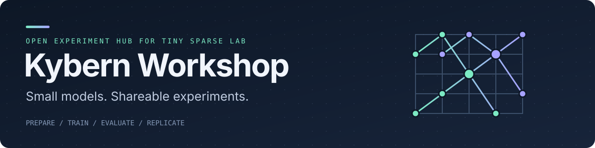

<p align="center">
  
</p>

<p align="center">
  <a href="https://github.com/supernovae/kybern-workshop/actions/workflows/tinystories-rocm.yml"></a>
  <a href="https://github.com/supernovae/tiny-sparse-lab"></a>
  <a href="https://github.com/supernovae/tiny-sparse-lab"></a>
  <a href="docs/native-workflow.md"></a>
  <a href="https://kybern.dev"></a>
</p>

<p align="center">
  <a href="https://kybern.dev/models/tinystories-training/">TinyStories Guide</a> ·
  <a href="examples/synthetic-cpu/README.md">Basic CPU Smoke</a> ·
  <a href="experiments/devmind/README.md">DevMind 340M</a> ·
  <a href="#community-experiments--forks">Community Experiments</a> ·
  <a href="https://kybern.dev/experiments/">Kybern Research</a>
</p>

**Kybern Workshop** is the open experiment hub for **[Tiny Sparse Lab](https://github.com/supernovae/tiny-sparse-lab)**.
To keep individual studies decoupled from the core workbench engine, Workshop stores shareable, declarative experiment recipes—dataset locks, tokenizer configs, model `RunConfig` files, `try` interventions, and recorded run outputs—so anyone can inspect what we ran, replicate it on their own hardware, or fork a recipe to test a new idea.

We publish complete records—including negative results and models that lower validation loss while still failing generation rubrics—so you can see what actually happens inside small language models.

Active experiment recipes and published evidence live here in Workshop; Kybern’s backlog and coordination live in Notion. Neither Notion nor an internal runner is needed to use these recipes. The TinyStories scores are provisional assistant assessments, not independent human quality clearance. Model weights are retained locally and are not distributed by Workshop; reproductions train their own model with new run identities.

---

## Active Experiments & Recipes

| Experiment | What it tests | Status & Evidence | Links |
| --- | --- | --- | --- |
| **TinyStories Baseline (4.46M)** | Full 8,192-update (33.5M-token) CPU training run of a 4-layer dense transformer with a 12-prompt story continuation panel. | **Completed baseline.** Validation loss reached `1.7043` (perplexity `5.4976`), while 22/24 scored continuations failed the provisional assistant-scored quality rubric—a concrete baseline to improve. | [Walkthrough](examples/tinystories-useful/README.md) · [27 Recorded Outputs](results/2026-10-19-tinystories-cpu/README.md) · [Interactive Guide](https://kybern.dev/models/tinystories-training/) |
| **TinyStories Microlab** | Starter paired comparison (`FFN width 256` vs. `384`) on 2,000 stories using `sparselab try`. | **Ready to run.** 40-update (10,240-target) teaching comparison for learning the `sparselab` workflow. | [Microlab Guide](examples/tinystories-microlab/README.md) · [Container Smoke Result](results/2026-10-15-tinystories-smoke/README.md) |
| **Basic Synthetic CPU** | Offline end-to-end smoke test: synthetic text generation, BPE tokenizer fitting, 1-step training, evaluation, and verified reporting. | **Measured & verified.** Runs completely offline on CPU with zero dataset or model downloads. | [Recipe Guide](examples/synthetic-cpu/README.md) · [Recorded Result](results/2026-10-14-synthetic-cpu/README.md) · [Offline Check (kybern.dev)](https://kybern.dev/models/cpu-smoke/) |
| **DevMind 340M Base** | ~342M-parameter dense base model (24 layers, width 1,024, SwiGLU, RoPE) and a 12B unique-target 60/20/20 web/synthetic/code experiment. | **Preparation partially complete; model execution stopped.** Corpus R36 and 32K tokenizer R40 retained; 49 additional code shards acquired, not admitted. Scientific 12B mixture incomplete. [Bind, run and revise](experiments/devmind/run.md). | [DevMind Overview](experiments/devmind/README.md) · [Scientific Protocol](experiments/devmind/protocol.md) · [Pilot Status (kybern.dev)](https://kybern.dev/models/devmind/) |

---

## Running Workshop Experiments with Tiny Sparse Lab

All recipes in this repository execute inside **[Tiny Sparse Lab](https://github.com/supernovae/tiny-sparse-lab)**.
Install **Python 3.14** and [uv](https://docs.astral.sh/uv/), then clone both repositories side by side:

```sh
git clone https://github.com/supernovae/tiny-sparse-lab.git
git clone https://github.com/supernovae/kybern-workshop.git

cd tiny-sparse-lab
uv sync --locked --extra cpu --dev
export SPARSELAB_WORK_DIR="$HOME/.local/share/sparselab"
```

### 1. Run a Quick Offline CPU Smoke Test

Verify your local installation end-to-end without downloading any external datasets (see the [Offline Installation Check on kybern.dev](https://kybern.dev/models/cpu-smoke/)):

```sh
uv run --locked --extra cpu sparselab readiness smoke --family dense \
  --output "$SPARSELAB_WORK_DIR/first-run"
uv run --locked --extra cpu sparselab dashboard --runs-dir "$SPARSELAB_WORK_DIR/first-run/runs"
```

Want to inspect or replicate the full multi-stage synthetic campaign recipe? Follow [`examples/synthetic-cpu/README.md`](examples/synthetic-cpu/README.md).

### 2. Run Your First Controlled Comparison (`TinyStories Microlab`)

Copy the [TinyStories microlab declarations](examples/tinystories-microlab/README.md) into a fresh workspace directory, prepare the dataset and 2,048-token BPE tokenizer once, and test whether a wider feed-forward layer (`ffn_dim: 384` vs. `256`) lowers held-out loss at the same token budget:

```sh
EXPERIMENT="$SPARSELAB_WORK_DIR/experiments/tinystories-microlab-001"
SAMPLE="../kybern-workshop/examples/tinystories-microlab/declarations"
mkdir -p "$EXPERIMENT/inputs"
cp "$SAMPLE/source.yaml" "$SAMPLE/tokenizer.yaml" "$SAMPLE/run.yaml" "$EXPERIMENT/inputs/"

# 1. Lock and snapshot the TinyStories subset, then fit the tokenizer
uv run --locked --extra cpu sparselab data lock "$EXPERIMENT/inputs/source.yaml" \
  --output "$EXPERIMENT/inputs/source.lock.json"
uv run --locked --extra cpu sparselab data snapshot "$EXPERIMENT/inputs/source.lock.json" \
  --output "$EXPERIMENT/snapshot"
uv run --locked --extra cpu sparselab tokenizer train "$EXPERIMENT/inputs/tokenizer.yaml"

# 2. Run a matched comparison: FFN width 384 vs. baseline 256
cat > "$EXPERIMENT/wider-ffn.yaml" <<'YAML'
question: Does a wider FFN lower held-out loss at the same token budget?
set:
  model.ffn_dim: 384
YAML

uv run --locked --extra cpu sparselab try "$EXPERIMENT/wider-ffn.yaml" \
  --vs "$EXPERIMENT/inputs/run.yaml"
```

Once `try` finishes, use the printed `TRY_ID` to inspect the verdict, run deeper behavioral probes, or launch the visual dashboard:

```sh
uv run --locked --extra cpu sparselab report TRY_ID
uv run --locked --extra cpu sparselab explore TRY_ID
uv run --locked --extra cpu sparselab dashboard
```

### The Everyday Experiment Loop

| Goal | Tiny Sparse Lab Command | What it does |
| --- | --- | --- |
| **Validate a config** | `sparselab config validate run.yaml --kind run` | Checks YAML/JSON declarations before any data or training work runs. |
| **Test one change** | `sparselab try DELTA.yaml --vs BASELINE.yaml` | Trains baseline & candidate (or reuses a verified baseline), scores held-out loss, and runs fast probes. |
| **Read the verdict** | `sparselab report TRY_ID` | Prints the sealed comparison report, metrics delta, and probe summary. |
| **Inspect weights & loss** | `sparselab explore TRY_ID` | Computes per-token loss, attention maps, and weight statistics. |
| **Generate text** | `sparselab generate RUN_ID --checkpoint CHECKPOINT --prompt "..."` | Runs deterministic or sampled continuations from a verified checkpoint. |
| **Browse visually** | `sparselab dashboard` | Opens the local web UI for runs, Pareto frontiers, probes, and checkpoints. |

---

## Community Experiments & Forks

As Tiny Sparse Lab grows, this section tracks reproducible small-model experiments, replications, and baselines shared by the community in their own forks and repositories.

| Project / Fork | Author | Question / Experiment | Model & Backend | Summary / Findings |
| --- | --- | --- | --- | --- |
| *No community forks listed yet — yours could be the first!* | — | Run a replication, test an architectural change, or try to beat our [TinyStories baseline](examples/tinystories-useful/README.md). | CPU / GPU / MLX | **[Open a PR](CONTRIBUTING.md) to add a link to your fork or experiment here! 🙂** |

**Have an experiment in your fork?** We'd love to feature it! Whether you replicated a recipe on new hardware (CUDA, ROCm, Intel XPU, or Apple Silicon MLX), improved story coherence on TinyStories, or tested a clean negative result, open a pull request to add your repository to the table above. See [CONTRIBUTING.md](CONTRIBUTING.md) for details.

---

## Learn & Explore on [kybern.dev](https://kybern.dev)

Our website pairs directly with the recipes in this repository:

- **[TinyStories: Build, Read, and Improve a Small Story Model](https://kybern.dev/models/tinystories-training/)** — Step-by-step walkthrough plus an interactive browser viewer for all 27 recorded story outputs.
- **[Offline CPU Installation Check](https://kybern.dev/models/cpu-smoke/)** — Quick local verification guide for new Tiny Sparse Lab installs.
- **[DevMind Pilot Status](https://kybern.dev/models/devmind/)** — Overview of the DevMind 340M Base pilot and preparation milestones.
- **[Experiments & Research Roadmap](https://kybern.dev/experiments/)** — Pending studies on conditional memory, fact swaps, context overrides, and ideas you can test on your own hardware.
- **[Matched Comparisons](https://kybern.dev/learn/lab/matched-comparisons/) & [Inspecting Runs](https://kybern.dev/learn/lab/inspect-runs/)** — How to design controlled experiments with paired seeds and interpret probe verdicts.
- **[Free 18-Lesson Curriculum](https://kybern.dev/learn/)** — Hands-on lessons from tensors and autograd to building a causal decoder and running controlled lab comparisons.

---

## Repository Structure

```text
kybern-workshop/
├── examples/
│   ├── synthetic-cpu/         # Offline synthetic CPU smoke recipe
│   ├── tinystories-microlab/  # 40-update FFN width comparison (256 vs. 384)
│   ├── tinystories-useful/    # 8,192-update CPU baseline recipe & improvement exercises
│   ├── tinystories-worker/    # Paired CPU worker campaign recipe
│   └── tinystories-rocm/      # Containerized AMD ROCm campaign recipe
├── experiments/
│   └── devmind/               # DevMind 340M Base protocol, model/optimizer configs & 25-leaf corpus prep
├── results/
│   ├── 2026-10-14-synthetic-cpu/     # Recorded synthetic CPU smoke metrics & report
│   ├── 2026-10-15-tinystories-smoke/ # Recorded paired CPU container smoke summary
│   └── 2026-10-19-tinystories-cpu/   # Recorded 8,192-update baseline metrics & 27 story outputs
└── docs/
    ├── native-workflow.md     # Guide to packaging, inspecting & running recipes with sparselab
    └── operator.md            # Optional Docker campaign supervisor helper reference
```

## Contributing

Pull requests for experiment replications, new declarative recipes, baseline improvements, and links to community forks are welcome! Read [CONTRIBUTING.md](CONTRIBUTING.md) and the [Kybern Community Lab guide](https://kybern.dev/research/community-lab/) to get started.
