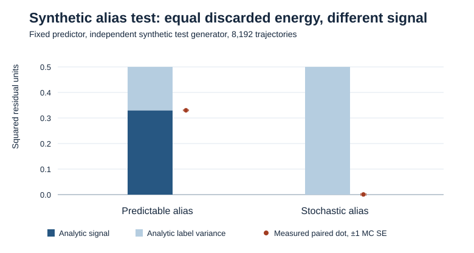

# CPU mechanism preregistration: M1–M3

Registered at 2026-11-18 14:29:59 UTC before generating or reviewing the three numerical outcomes. Scope: three NumPy FP64 examples, one invocation, single-threaded local WSL2 CPU, at most ten process CPU-minutes total. No checkpoint access, model training jobs, GPU, or TinyStories inference. Seeded examples are algebra/mechanism tests, not independent training replicates. One-step toy clones and analytic evaluation points specified below are controls within their example, not selectable configurations.

## M1: retrospective capture versus matched drift

- Freeze a centered residual with non-isotropic energy in (V=9) and a start basis of rank (r=2), hence ambient centered dimension (n=8). Principal angles: 0.25 and 0.85 radians. The seeded null uses 8,192 independent Haar orientation draws into the 6-dimensional original complement (NumPy PCG64 seed 18011), leaving the in-plane components/angles unchanged.
- Primary endpoint: Monte Carlo mean ‖Rₜ Qₛ‖²_F / ‖Rₜ‖²_F vs analytic matched-drift expectation (r − ‖Qₜᵀ Qₛ‖²_F) / (n − r). Include standard error, identical-basis capture, and test that the simulated draws preserve ‖Qₜᵀ Qₛ‖²_F. Falsifiers: mean off by more than five Monte Carlo SE plus 1e−12; no-drift capture or maximum drift error above 1e−12. This is a test of the null, not evidence of excess structured capture in a trained model. Different ranks/saturated complement fall outside this formula.

## M2: ordinary head adaptation and next-batch feedback

- Freeze one linear untied head (9 classes, hidden width 3), fixed vocabulary bias and linear trunk (5 inputs). Seed 18021 supplies the starting tensors, a synthetic classification teacher and independently sampled input/target sets A/B/C (128/192/256 rows, disjoint). Share initial tensors and sets across clones. No external data or optimizer state.
- A supplies the head-only update, B supplies at most one exact mean-CE trunk-only gradient step, C is read-only. Compare frozen, no A-head step, full, parallel-only, residual-only A-head steps; parallel and residual also get a same-realized-Frobenius-norm control matched to full. Plain SGD step eta=0.04 for A and B, no momentum, decay, clipping or tuning. Clone the initial tensors per arm and recompute B probabilities after the head step.
- Primary mechanism check: on B, compare G_B ΔW_perp to −η (R_B R_Aᵀ) H_A / N_A, both using the original orthogonal decomposition/projector. Unreduced rows are used in this comparison. Measure all three terms of the actual change G_B ΔW + ΔG_B W + ΔG_B ΔW in Frobenius norm. Falsifiers: identity or recomposition discrepancy above 1e−12, or compared realized head Frobenius norms not matched to 1e−12.
- Primary numerical loss endpoint: C mean CE after exact B step (record baseline, head-only and post-B, plus first-order C predictions for the individual steps). Observed changes must not undershoot the individual first-order predictions by more than 1e−12 (CE convex in logits). No directional learning-effect prediction or promotion based on this fixture. An AdamW checkpoint comparison and forward-matched stale or filtered backward control remain future work.

## M3: conditional signal vs label noise

- Three canonical tokens and two output aliases per canonical, six classes. Context is previous canonical token plus independent uniform cue bit. Initial previous canonical is uniform. Next canonical is the cyclic successor with probability 0.8, either other token with probability 0.1 each. Feed only canonical values from the first draw into the subsequent context. Both arms use the same primary and paired canonical draws, input cues and primary canonical trajectories. Predictable alias copies the cue. Stochastic alias draws an independent fair bit per target draw. The resulting population class frequency is exactly 1/6 for each class in both arms. Do not force empirical counts to match: that could alter the paired-target independence. Report empirical marginals/check one-to-one context pairing.
- Use 8,192 independent length-four trajectories in each of two splits, train-generator stream PCG64 seed 18031 and test-generator stream 18032. The “train” split is a generator replication/check only; no optimization. Draw a separate second next canonical and stochastic alias at the same fixed context, conditional on that context only. The second draw never enters the canonical history. Treat trajectories, not positions, as MC replication units.
- Both arms use the same fixed linear head and context features (one-hot canonical plus cue). Symmetric alias rows produce logits for the true canonical conditional; cue weight is zero by construction. Thus p = q_stochastic exactly (up to rounding). Compute a centered numerical basis with the standard FP64 matrix-rank tolerance; hold it fixed across samples and arms.
- Primary measurements: full/canonical/conditional-alias NLL, known entropy floor, excess full NLL; total null residual energy, label variance, predictable squared mean residual, and paired same-context residual dot product. Use the analytic conditional identity E[‖r‖²] = ‖E[r]‖² + tr[(I − P)(diag(q) − qqᵀ)]. Primary falsifier: estimated residual energy or paired dot differs from analytic target by more than five trajectory-level MC SE plus 1e−12; analytic identity/chain-rule discrepancy above 1e−12; or the matched population/analytic invariants fail.
- Predictions made before execution: both arms have exactly equal total null energy (1/2); true stochastic paired signal is zero and excess NLL is zero; predictable signal is (0.5(0.8^2+2(0.1^2))=0.33), and predictable excess NLL is ln 2. The alias NLL is ln 2 in both because the fixed predictor ignores cue. No mechanism/outcome implies these quantities for TinyStories or predicts an effective intervention.

Code lives in Model Lab; compact measured data will be recorded in `results/mechanisms-cpu.json`. These tests can be reproduced with a provisioned Lab environment that already has NumPy; no dependency changes are required.

## Results and interpretation

All registered checks passed on the local WSL2 CPU at 14:35 UTC. Python 3.14.4, NumPy 2.5.3, FP64, one thread. The one invocation used 0.287 seconds of process CPU time through collection and a peak RSS of about 78 MiB. [Compact machine-readable record](results/mechanisms-cpu.json).

### M1: match the drift before interpreting overlap

Write the future frame in principal coordinates as the sum of its starting-plane component and an orthogonal-complement frame with normal component lengths sin(θⱼ). Fix the angles and average over uniform orientations of only the latter frame. Rotational symmetry makes its expected energy operator in the complement a scalar times the identity; taking its trace gives that scalar as sumⱼ sin²(θⱼ)/(n − r). The fixed residual has no starting-plane component, so that scalar is precisely the expected capture fraction.

The expected capture was 0.104272. The seeded randomized mean was 0.104431 (MC SE 0.000863), with overlap preserved within 1.56e−15 and same-basis capture 3.99e−33. A later overlap of roughly 10% in this fixture is explainable without structured reuse. Real checkpoint pairs still require raw and centered measures, rank checks, fixed training-only probes and stratified controls.

### M2: the head effect is real, but distinct from a surrogate route

The residual-transfer identity on disjoint B matched within 1.41e−18 max absolute error. In the residual-only arm the three unreduced B feedback norms were 0.011050, 0.000506 and 0.00000441, respectively. The direct term can exist even though the original residual did not reach the trunk. Recomputing probabilities captures the other two terms.

| A head step | Realized head step norm | C CE after head only | C CE after B |
|---|---:|---:|---:|
| Frozen (no A or B step) | 0 | 2.224190 | 2.224190 |
| None | 0 | 2.224190 | 2.221300 |
| Full | 0.005108 | 2.223708 | 2.220831 |
| Parallel | 0.004517 | 2.223863 | 2.220987 |
| Residual | 0.002385 | 2.224035 | 2.221144 |
| Parallel, norm-matched to full | 0.005108 | 2.223820 | 2.220946 |
| Residual, norm-matched to full | 0.005108 | 2.223859 | 2.220966 |

These are one-seed, finite-step toy CE values in nats per target, not evidence for training efficacy. The head changes predictions on C before B is taken. Therefore post-B loss alone does not isolate the changed backward route. The useful subsequent causal control is the same realized head/forward state with exact versus stale or filtered trunk feedback, evaluated on independent C, with matched trunk update size.

### M3: the same discarded energy can encode error or noise



| Independent synthetic test | Predictable alias | Stochastic alias |
|---|---:|---:|
| Observed mean squared null norm per target | 0.500000 | 0.500000 |
| True squared conditional mean residual | 0.330000 | 0 |
| True conditional sampling variance in the null space | 0.170000 | 0.500000 |
| Observed paired residual dot product (MC SE) | 0.330185 (0.001310) | 0.000595 (0.002249) |
| Exact conditional canonical NLL (nats) | 0.639032 | 0.639032 |
| Exact conditional alias NLL (nats) | 0.693147 | 0.693147 |
| Exact conditional full NLL (nats) | 1.332179 | 1.332179 |
| Known entropy floor (nats) | 0.639032 | 1.332179 |
| Exact excess NLL (nats) | 0.693147 | 0 |

Population marginals matched exactly, and empirical first-target class marginals differed by at most 0.001343 on the test generator. The primary canonical sequence was exactly shared. In the stochastic arm the fixed predictor already equals q, yet the sampled null residual persists. In the predictable arm it ignores a cue that really could remove the excess loss. This distinguishes irreducible alias randomness from systematic conditional error in the toy; the paired estimator requires independently drawn targets at the same context, which real TinyStories text does not provide as known conditional truth.

### Reproduce or check the analysis

The active Model Lab code supplies only general, array-level operations in `klab.research.routing_mechanisms`. From the Lab checkout with the provisioned CPU Python environment activated, these neutral regression tests verify those operations:

```sh
OMP_NUM_THREADS=1 MKL_NUM_THREADS=1 OPENBLAS_NUM_THREADS=1 \
PYTHONPATH="$PWD/src" python -m pytest -q tests/test_routing_mechanisms.py
```

From this Workshop directory, `python -m json.tool results/mechanisms-cpu.json` reads and validates the recorded results. The appendix below specifies the complete numerical reconstruction from the fixed inputs and the public primitives. There is no current standalone study runner or helper to install or execute. The SVG is a static view of the recording, not another simulation.

## Numerical reconstruction appendix

Use the recorded NumPy 2.5.3 and FP64 for the calculations, PCG64 as supplied by `numpy.random.default_rng`, one BLAS thread, and the exact RNG call order below. Use ordinary dense arrays in these tiny examples. For row logits, subtract the row maximum, exponentiate and divide by the row sum; for labels use `G = p − one_hot(y)`, with no mean reduction in G. Head convention: `Z = H Wᵀ + b`. Numerical bases are the thin SVD left columns whose singular values exceed `eps(float64) × max(matrix.shape) × largest_singular_value`. No vocabulary-square projector is needed.

### M1: fixed residual and random complement

1. Thin-QR the 9-by-8 matrix whose zero-indexed column j is `e_j − e_8`; call the first two Q columns T, the remaining six F. Form the four residual rows `4F[:,0]`, `F[:,0]+F[:,2]`, `2F[:,3]` and `0.5F[:,4]`. Each is orthogonal to T. Denote their stack R.
2. In each column use its specified angle, in order 0.25 and 0.85 radians. The reference future basis is T scaled by cosines plus the first two F columns scaled by sines. Use `matched_drift_null(T, future, ambient_dimension=8)` for the analytic null; `captured_residual_energy(R, T)` gives the no-drift check.
3. From seed 18011 draw standard normals in shape (8192, 6, 2) in one call. Thin-QR each matrix and multiply each Q column by the sign of its corresponding R diagonal. For each signed Q frame S, substitute F S for the two complement columns of the reference basis. Keep the cosine and sine scaling fixed. Compute capture with `captured_residual_energy`; report the mean and sample SD divided by √8192. Verify that the squared Frobenius overlap with T agrees with the squared cosines summed over columns.

### M2: field definitions for the disjoint clone comparison

1. Spawn four child seeds from `SeedSequence(18021)`, in order model, A, B, C. Call the model stream's zero-mean normal generator in order: W (9,3), SD 0.35; b (9,), SD 0.15; trunk matrix T (5,3), SD 0.30; teacher-W offset (9,3), SD 0.65; teacher-T offset (5,3), SD 0.50. Mean-center the initial W by column before forming teacher W. Add the offsets to form the teacher matrices; the teacher uses the same b.
2. In each of the separate A/B/C streams, draw X of shape (128,5), (192,5), or (256,5), respectively, from a standard normal. Then take one Uniform(0,1) draw per row in shape (batch size, 1). The target index is the count of teacher-softmax cumulative probabilities strictly less than that row's uniform draw. The teacher logits are `X T_teacher W_teacherᵀ + b`. All clones use the same starting tensors and draw results.
3. For each batch set `H = X T`, get p and G, and form Q from initial W. Use `residual_component(G, Q)` to get R. A's full, parallel and residual head deltas are respectively `−η G_Aᵀ H_A/N_A`, `−η (G_A−R_A)ᵀ H_A/N_A` and `−η R_Aᵀ H_A/N_A`, with η=0.04. The two matched updates each scale their original delta by the unscaled full delta's Frobenius norm divided by their own. In frozen and no-head arms use zero A delta.
4. Independently compare `G_B ΔW_residual` with `−η (R_B R_Aᵀ) H_A/N_A`, with the initial probabilities fixed. On each arm recompute B logits at `W′ = W + ΔW`, with b and T unchanged. Use `hidden_feedback_change(G_B, G′_B, W, W′)` for all three unreduced terms and verify their sum against `G′_B W′ − G_B W`. Take a trunk-only step `ΔT = −η X_Bᵀ (G′_B W′) / N_B` except in the frozen arm, where ΔT is zero.
5. Score C at initialization, after A and after B. In the two single-coordinate perturbations compare actual CE changes separately with first-order predictions: average per-row inner products of initial C error with `H_C ΔWᵀ`, then of post-head C error with `X_C ΔT W′ᵀ`. Check nonnegative convexity slack up to the registered tolerance. The archived norm controls report the realized norm `‖W′−W‖_F`.

### M3: sample construction and known target

1. Use 8,192 trajectories of four transitions, on independent PCG64 streams 18031 (train-generator check only) and 18032 (test). In each stream, first draw the initial previous canonicals with `integers(3, size=8192)`, then all cues with `integers(2, size=(8192,4))`. For each step in order, draw offsets in one `choice(3, size=(8192,2), p=(0.1,0.8,0.1))` call. Add the current previous canonical to each offset modulo 3 to get paired canonical targets. Only the first target becomes the next previous canonical. After all four transitions, draw the stochastic aliases with `integers(2, size=(8192,4,2))`. Predictable aliases are copies of the recorded context cue, not additional draws. Class ID is twice the canonical ID plus the alias bit. Retain trajectory-major row order for reductions.
2. Given previous canonical j, the canonical conditional is the cyclic roll by j of (0.1, 0.8, 0.1). Context features are the one-hot previous canonical and the cue. Set W row `2k + a` to the log probabilities of next canonical k for all three previous canonicals, followed by zero cue weight, for each alias a. Softmax with these logits and zero bias. Form Q from W after subtracting its vocabulary-row mean. The stochastic q gives each alias half the canonical conditional mass; the predictable q gives it all to the cue alias. Thus the stochastic truth equals p and the two arms have the same p, same canonical pairs, and same context.
3. Use `conditional_residual(p, q, Q)` to compute rowwise squared mean, projected label covariance trace, and total energy. The latter is also a direct expectation via the projected p and the projector diagonal, separately from adding mean and variance. Use `conditional_alias_nll(p, q, aliases_per_class=2)` for full, canonical, alias, floor (entropy of q), and excess NLL. Canonical probabilities sum the two aliases; conditional alias probabilities divide the alias probability by that canonical sum. Sample NLL uses the first draw and remains distinct from exact conditional NLL.
4. For each paired target, use `residual_component(p − one_hot(y), Q)` on both draws. Per position calculate the first residual's squared norm and the pair's inner product. Average each quantity across the four positions within each trajectory, then average across trajectories and use their sample SD divided by √8192 as Monte Carlo SE. Class marginals are first-draw normalized counts; decide population marginals from uniform stationary canonicals and independent uniform cue or alias.
5. In this symmetric head the null residual is confined to the target canonical's alias contrast and is a signed half of the difference of its two alias basis vectors. Its squared norm is 1/2. Predictable aliases give the same sign on both target draws, so the expected dot is 1/2 times the probability that the independent canonicals match: `0.5 × (0.8² + 0.1² + 0.1²) = 0.33`. Stochastic alias signs are independent with mean zero. This gives projected label variance of 0.17 and 0.50, respectively. The canonical entropy floor is `−0.8 ln(0.8) − 2 × 0.1 ln(0.1)` in both; add ln(2) only to the stochastic floor. Since p is alias-symmetric, exact full and alias CE agree across arms, but the floor/excess partition differs.

### Static chart definition

The [SVG](results/m3-synthetic-alias.svg) uses `m3.independent_test_generator.arms` in the data record. Each bar starts at zero and stacks `analytic_signal` followed by `analytic_label_variance`. Each offset dot and error bar display `paired_same_context_residual_dot.mean` and ±1 `se`. Same energy units and scale for all marks (y = 320 − 420 × value in the SVG coordinates). The analytic bars and the measured dots are separate marks; the latter are not estimated variances or training-seed error bars. This states the rendering sufficient to reproduce or restyle the figure in any charting tool.

### Historical audit only: exact original invocation

The original scientific payload can also be reconstructed from the pinned **local** Model Lab study snapshot `e02bfdb78b1553d81251d25e678c4a36ad47be84`. This is historical provenance, not a dependency of the current product, and the snapshot has not been published. Keep the active checkout unchanged: run from the Model Lab repository with the provisioned CPU Python active, set `AUDIT_DIR` to a new empty directory outside either worktree, and use only the four pinned source files below. The invocation replays only the archived NumPy calculation, not training, and stdout does not include the original timestamps or resource usage.

```sh
git archive e02bfdb78b1553d81251d25e678c4a36ad47be84 \
  src/klab/__init__.py src/klab/research/__init__.py \
  src/klab/research/routing_mechanisms.py tests/routing_mechanism_fixtures.py |
  tar -xf - -C "$AUDIT_DIR"
OMP_NUM_THREADS=1 MKL_NUM_THREADS=1 OPENBLAS_NUM_THREADS=1 \
PYTHONPATH="$AUDIT_DIR/src:$AUDIT_DIR/tests" python -c \
'import json; from routing_mechanism_fixtures import m1_drift_fixture as m1, m2_head_step_fixture as m2, m3_alias_fixture as m3; print(json.dumps({"m1": m1(seed=18011, draws=8192, angles=(0.25,0.85)), "m2": m2(seed=18021, batch_sizes=(128,192,256), eta=0.04), "m3": {"train_generator_only": m3(seed=18031, trajectories=8192, steps=4), "independent_test_generator": m3(seed=18032, trajectories=8192, steps=4)}}, indent=2, allow_nan=False))'
```
